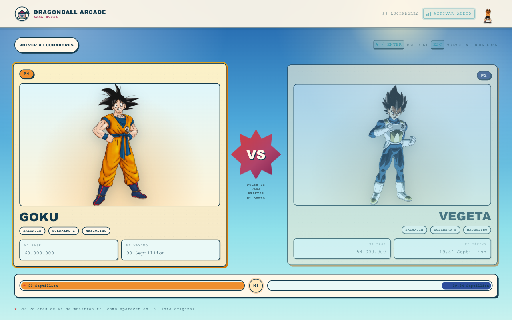
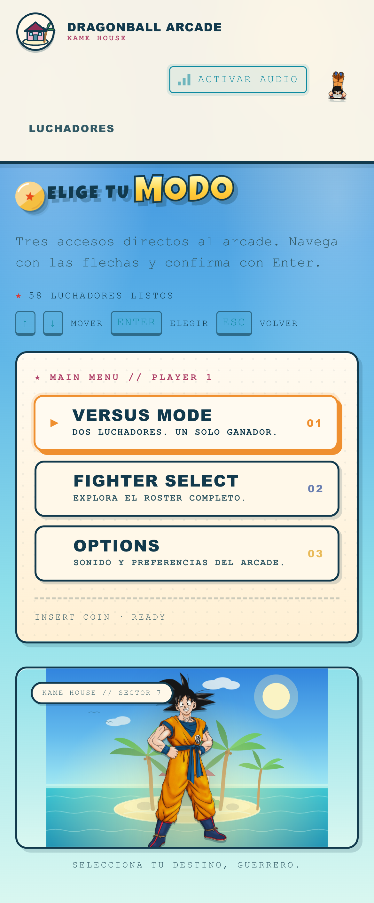

# Dragonball Arcade

SPA de personajes de Dragon Ball con estética de arcade retro, construida con React 19, TypeScript y Vite. La aplicación consume la [Dragonball API](https://web.dragonball-api.com/) y ofrece un flujo completo de selección de luchadores: menú principal arcade, roster, ficha de personaje y combate para dos jugadores.

**Demo:** [christianjtr.github.io/dragonball-characters](https://christianjtr.github.io/dragonball-characters/)

## Capturas

| Menú principal | Selección Personaje | Modo versus |
| --- | --- | --- |
|  |  |  |

Vista móvil del menú: 

## Versión 2.0 (actual)

- **Menú principal tipo arcade:** título con bola de dragón, Kame House, luchador destacado y opciones de Versus, Fighter Select y Options con navegación por teclado, ratón y táctil.
- **Roster de 58 luchadores:** búsqueda por nombre, filtros por raza y afiliación, orden alfabético y estado de la URL compartible.
- **Ficha de personaje:** retrato, ki, descripción, planeta de origen y transformaciones.
- **Modo versus 2P:** selección de dos luchadores y pantalla de enfrentamiento.
- **Interfaz en español:** etiquetas traducidas para razas, afiliaciones, géneros y estados.
- **Diseño responsive:** layout adaptado a escritorio, tablet y móvil.
- **Audio de arcade:** efectos de navegación y música de fondo con controles separados en Options, persistidos en `localStorage`; el audio arranca desactivado y respeta las restricciones de autoplay.
- **Accesibilidad:** navegación completa por teclado, foco gestionado, textos alternativos y respeto a `prefers-reduced-motion`.
- **GitHub Pages:** fallback de rutas SPA mediante `public/404.html` y `.nojekyll`.

## Stack

- [React 19](https://react.dev/)
- [TypeScript](https://www.typescriptlang.org/)
- [Vite](https://vitejs.dev/)
- [React Router](https://reactrouter.com/)
- CSS puro con tokens y componentes propios
- [Luckiest Guy](https://fontsource.org/fonts/luckiest-guy) para el logotipo
- Vitest + Testing Library para pruebas de interacción

## Instalación y scripts

Requiere [Node.js](https://nodejs.org/) y pnpm.

```shell
git clone https://github.com/christianjtr/dragonball-characters.git
cd dragonball-characters
pnpm install
```

```shell
# Entorno de desarrollo
pnpm dev

# Verificación de tipos
pnpm typecheck

# Lint
pnpm lint

# Pruebas
pnpm test

# Build de producción
pnpm build
```

## Audio

La música de fondo usa el instrumental TV-size de **Romantic Ageru Yo**, ending de **Dragon Ball**, publicado en Internet Archive bajo licencia **Creative Commons Attribution-NonCommercial-NoDerivatives 4.0 International (CC BY-NC-ND 4.0)**. Se usa el MP4 original sin modificaciones.

- Archivo: `public/audio/dragon-ball-romantic-ageru-yo.mp4`
- Fuente: [Internet Archive](https://archive.org/details/OG-DB-Ending-Original-Instrumental)
- Créditos completos: `public/audio/CREDITS.md`
- El audio arranca desactivado; se activa desde `OPTIONS` (efectos y música por separado) o con el interruptor del header. Las preferencias se guardan en `localStorage`.

## Estructura

```text
src/
  components/   Componentes visuales reutilizables
  config/       Configuración del arcade
  context/      Estado de sonido y roster
  hooks/        Audio, datos, navegación y utilidades
  layouts/      Header y layout principal
  pages/        Menú principal, roster, ficha y versus
  services/     Cliente y servicios de la Dragonball API
  styles/       Tokens y estilos globales del arcade
  utils/        Filtros, orden, etiquetas y temas
```

## Versión 1.0

La primera versión nació como assessment técnico: listar personajes de la Dragonball API, ordenarlos alfabéticamente y abrir una vista de detalle con información adicional e imagen. Se implementó con React 19 + TypeScript + Vite, sin framework CSS, y sentó la base de componentes y servicios que hoy usa la experiencia arcade.
