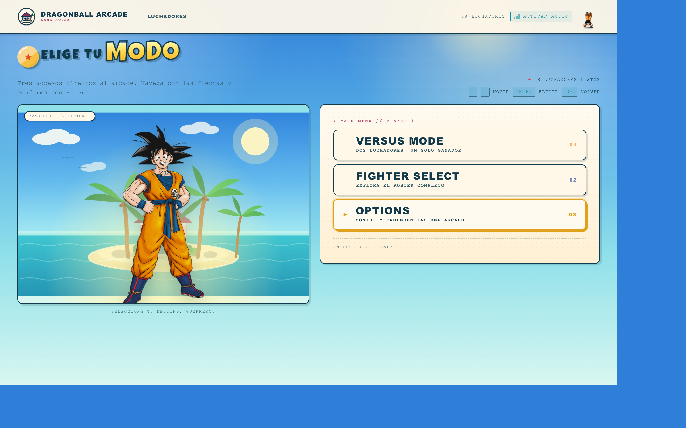
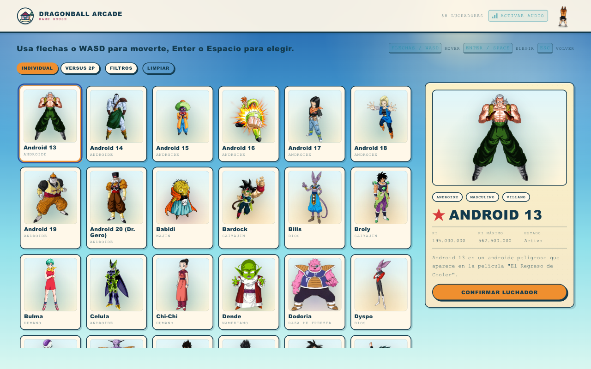

# Dragonball Arcade

A retro arcade-style Dragon Ball character SPA built with React 19, TypeScript, and Vite. It uses the [Dragonball API](https://web.dragonball-api.com/) and brings together an arcade home menu, individual and versus character selection, fighter profiles, and a versus screen.

**Demo:** [christianjtr.github.io/dragonball-characters](https://christianjtr.github.io/dragonball-characters/)

## Screenshots

| Home menu | Character selection | Versus |
| --- | --- | --- |
|  |  |  |

## Features

- **Arcade home menu:** one Play entry and Options, controlled by keyboard, mouse, or touch.
- **58-character roster:** search, race and affiliation filters, sorting, and shareable selection state in the URL.
- **Individual selection:** browse the character grid and open a fighter preview/profile.
- **Versus selection:** choose Individual or Versus 2P from the selection screen. Pick P1 and then P2, change or cancel picks, and start the match. On mobile, a centered ready modal helps decide when both fighters are picked. Entering Versus mode pushes browser history, so Back returns to Individual mode.
- **Multimodal controls:** Arrow keys or WASD to navigate; Enter or Space to confirm; Escape to go back. The native Gamepad API supports D-pad/stick navigation, confirm/back buttons, and optional haptic feedback where supported by the controller and browser.
- **Arcade feedback:** Web Audio synthesized movement, confirm, lock-in, and transformation cues. Versus selections with available transformations receive a visual aura.
- **Recruiter easter egg:** enter ↑ ↑ ↓ ↓ ← → ← → B A on the character selection screen to reveal Christian J. Torrealba’s profile and CV link.
- **Fighter profiles:** portraits, Ki stats, descriptions, origin planets, and transformations.
- **Spanish UI and responsive design:** shared arcade tokens and components adapt to desktop, tablet, and mobile.
- **Accessibility:** keyboard support, managed focus, screen-reader labels, and `prefers-reduced-motion` support.
- **GitHub Pages:** pushes to `main` automatically build the app and publish only `dist/` to the `demo` branch. SPA routes use `public/404.html` as a fallback.

## Tech stack

- [React 19](https://react.dev/) and [TypeScript](https://www.typescriptlang.org/)
- [Vite](https://vite.dev/) and [React Router](https://reactrouter.com/)
- Custom CSS tokens and reusable components
- [Luckiest Guy](https://fontsource.org/fonts/luckiest-guy) display font
- Native Web Audio and Gamepad APIs
- Vitest + Testing Library

## Requirements and setup

Requires Node.js 22+ and pnpm 10.

```shell
git clone https://github.com/christianjtr/dragonball-characters.git
cd dragonball-characters
pnpm install
pnpm dev
```

## Scripts

```shell
pnpm dev         # Start the development server
pnpm typecheck   # TypeScript checks
pnpm lint        # ESLint
pnpm test        # Run Vitest tests
pnpm test:watch  # Run Vitest in watch mode
pnpm build       # Create a production build
pnpm preview     # Preview the production build
```

## Deployment

The [`.github/workflows/deploy-demo.yml`](.github/workflows/deploy-demo.yml) workflow runs on every push to `main` and can also be started manually from GitHub Actions. It installs dependencies, builds the app, and publishes only `dist/` to the `demo` branch.

The site is hosted at `https://christianjtr.github.io/dragonball-characters/`. The workflow sets `VITE_RECRUITER_CV_URL` to `https://christianjtr.github.io/` for the recruiter profile. Local builds use that URL by default; override it with:

```shell
VITE_RECRUITER_CV_URL=https://example.com/cv pnpm build
```

GitHub Pages must be configured to publish from the `demo` branch.

## Repository maintenance

[Dependabot](.github/dependabot.yml) checks the npm and GitHub Actions ecosystems weekly and groups the updates into a single pull request per ecosystem (up to 5 open at a time). Node.js 22+ and pnpm 10 are pinned in `package.json` via `engines` and `packageManager`, matching the deployment workflow.

## Audio

Background music uses the original TV-size instrumental of **Romantic Ageru Yo**, a Dragon Ball ending, published on Internet Archive under the **Creative Commons Attribution-NonCommercial-NoDerivatives 4.0 International (CC BY-NC-ND 4.0)** license. The original MP4 is used without modification.

- File: `public/audio/dragon-ball-romantic-ageru-yo.mp4`
- Source: [Internet Archive](https://archive.org/details/OG-DB-Ending-Original-Instrumental)
- Credits: `public/audio/CREDITS.md`
- Audio starts disabled. Enable it in `OPTIONS` or with the header toggle. Music and sound effects have separate settings saved in `localStorage`.

## Project structure

```text
src/
  components/   Shared UI components
  config/       Arcade and recruiter profile configuration
  context/      Audio and roster state
  hooks/        Audio, data, keyboard, and gamepad behavior
  layouts/      App layout and header
  pages/        Menu, selection, fighter profile, and versus
  services/     Dragonball API client and services
  styles/       Global arcade tokens and styles
  utils/        Filtering, sorting, labels, and themes
```

## Version 1.0

The first version began as a technical assessment: list characters from the Dragonball API, sort them alphabetically, and open a detail view. Its components and data services now power the arcade experience.
